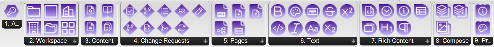

# GitBookConnect

GitBookConnect is a Grasshopper plugin for Rhino 7/8 (Windows and Mac) that wraps the [GitBook API](https://gitbook.com/docs/developers/gitbook-api/api-reference) to publish docs.
It browses organizations, spaces and published pages, builds GitBook pages from Grasshopper data (Markdown or rich, styled JSON), and writes them through GitBook's Change Request flow: open a Change Request, apply a batch of page and image changes, then review and merge.

- **Platform:** [GitBook API](https://gitbook.com/docs/developers/gitbook-api/api-reference) v1
- **Auth:** GitBook personal access token required, see [Authentication](authentication.md)
- **Version:** 1.0.0
- **Rhino support:** Rhino 7 (.NET Framework 4.8), Rhino 8 Windows (.NET 7), Rhino 8 Mac (.NET 7, untested)
- **License:** MIT
- **GitHub:** https://github.com/eesha-on-jupiter/GitBookConnect
- **Food4Rhino:** _(added once listed on food4rhino.com)_
- **Released:** _(added at first tagged release)_
- **Made with:** [PleaseREST](https://github.com/eesha-on-jupiter/PleaseREST)

_(Space for a demo video or GIF — drop it above or below this list once one exists.)_

## Features

- **Change Request write flow:** create, update, sync, request reviewers and merge Change Requests from the canvas, see [Change Requests tab](components/Change%20Requests/index.md).
- **One batch write:** [Apply Content Changes](components/Change%20Requests/ApplyContentChanges.md) sends up to 50 page and file changes in a single call.
- **Two page paths:** [Build Page (Markdown)](components/Pages/BuildPageMarkdown.md) for plain Markdown, [Build Page (JSON)](components/Rich%20Content/BuildRichPage.md) for styled blocks; both feed [Insert Page](components/Pages/InsertPage.md) and [Update Page](components/Pages/UpdatePage.md).
- **Pages from a data tree:** [Build Pages From Tree](components/Pages/BuildPagesFromTree.md) emits one insert or update per branch item, for one page per level, zone or element type.
- **Styled inline text:** chain [Text tab](components/Text/index.md) marks (bold, italic, strikethrough, code, keyboard, superscript, subscript, colour) onto a [Plain Text](components/Text/PlainText.md) run.
- **Rich blocks:** paragraphs, headings, hints, expandables, cards and tables in the [Rich Content tab](components/Rich%20Content/index.md).
- **Tables from grids:** a rows x columns tree becomes a [Table Block](components/Rich%20Content/TableBlock.md) or a [Markdown table](components/Pages/MarkdownTableFromGrid.md).
- **Images from any source:** [Build Insert File](components/Compose/BuildInsertFile.md) takes a file path, Bitmap, URL, base64 string or a live Rhino viewport capture.
- **Read-only navigation:** list and get organizations, spaces, collections and published pages, including [lookup by path](components/Content/GetPageByPath.md).
- **Presets:** value lists for [hint styles](components/Presets/HintStylePreset.md) and [colour tokens](components/Presets/TextColorPreset.md).

## Install

Install via the Rhino Package Manager (`PackageManager` command) and search for **gitbookconnect**, or drop the `.gha` (with the `.dll` files beside it) for your Rhino version into the Grasshopper `Libraries` folder and restart Rhino. On Rhino 8 the plugin needs the .NET Core runtime (the default): if the tab is missing, run `SetDotNetRuntime`, choose .NET Core and restart. Then follow the [Quickstart](quickstart.md).

## Components by tab

| Tab | Type | Components | What it's for |
|---|---|---|---|
| [Auth](components/Auth/index.md) | HTTP | 1 | Validate a personal access token |
| [Workspace](components/Workspace/index.md) | HTTP | 6 | List and get organizations, spaces and collections |
| [Content](components/Content/index.md) | HTTP | 4 | Read a space's published content and pages |
| [Change Requests](components/Change%20Requests/index.md) | HTTP | 9 | Create, apply content to, review, sync and merge Change Requests |
| [Pages](components/Pages/index.md) | JSON | 5 | Build Markdown page Document JSON and insert/update page Change JSON |
| [Text](components/Text/index.md) | JSON | 9 | Build styled inline text runs |
| [Rich Content](components/Rich%20Content/index.md) | JSON | 7 | Wrap text into paragraph, heading, hint, expandable, cards and table blocks, and build a JSON page from them |
| [Compose](components/Compose/index.md) | JSON | 3 | Insert files and images, aggregate blocks and changes |
| [Presets](components/Presets/index.md) | Preset | 2 | Value lists for hint styles and colour tokens |

46 components total.

## How writes are triggered

- GitBook has no direct "write a page" call: every content change goes through a Change Request, like a git branch and pull request.
- Every HTTP component (Auth, Workspace, Content, Change Requests) is button-triggered: it only calls GitBook when you click its button, never on recompute.
- Pages, Text, Rich Content, Presets and the two Compose aggregators are pure JSON assembly with no network call, safe to recompute freely.
- [Build Insert File](components/Compose/BuildInsertFile.md) is button-triggered too, so a viewport capture is taken on the click, but it makes no network call.
- The write chain: [Create Change Request](components/Change%20Requests/CreateChangeRequest.md) > [Content Changes Aggregator](components/Compose/ContentChangesAggregator.md) > [Apply Content Changes](components/Change%20Requests/ApplyContentChanges.md) > review at the Change Request `URL` > [Merge Change Request](components/Change%20Requests/MergeChangeRequest.md).
- Applied changes stay in the Change Request draft. Only Merge publishes them, and a merge cannot be undone through the API.

## Where to go next

- New to the plugin? Start with the [Quickstart](quickstart.md).
- Need a token? See [Authentication](authentication.md).
- What you can build: [Workflows](workflows.md), with step-by-step [Examples](examples/index.md).
- Release history: [Changelog](changelog.md).
